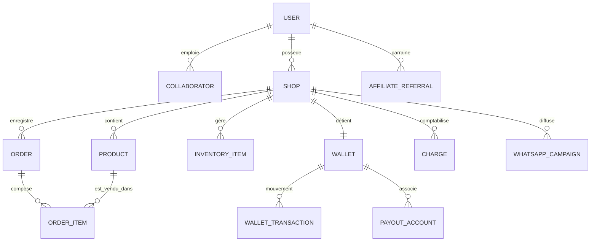

# Spécification & Architecture Backend FastAPI — Plateforme Kolix SaaS COD

> **Version** : 1.0.0 — Production-Ready  
> **Auteur** : Équipe d'Ingénierie Kolix  
> **Stack Technique** : Python 3.12+, **UV** (Package Manager), **FastAPI**, **Pydantic V2**, **SQLAlchemy 2.0 (Async)**, **Alembic**, **PostgreSQL 16**, **Redis 7**, **MinIO / AWS S3**, **LiteLLM / Gemini API**, **Docker**.

---

## Sommaire

1. [Vision & Principes d'Architecture](#1-vision--principes-darchitecture)
2. [Gestion de Projet & Tooling Moderne avec UV](#2-gestion-de-projet--tooling-moderne-avec-uv)
3. [Configuration & Variables d'Environnement (.env)](#3-configuration--variables-denvironnement-env)
4. [Sécurité, Authentification & Hachage Moderne](#4-sécurité-authentification--hachage-moderne)
5. [Modélisation Exhaustive des Données (PostgreSQL & SQLAlchemy 2.0 Async)](#5-modélisation-exhaustive-des-données-postgresql--sqlalchemy-20-async)
6. [Inventaire Exhaustif des Endpoints API RESTful (FastAPI v1)](#6-inventaire-exhaustif-des-endpoints-api-restful-fastapi-v1)
7. [Gestion du Stockage d'Objets & Médias (S3 / MinIO)](#7-gestion-du-stockage-dobjets--médias-s3--minio)
8. [Architecture IA & LLM (Assistant Kolix AI)](#8-architecture-ia--llm-assistant-kolix-ai)
9. [Système Asynchrone & Tâches d'Arrière-Plan (Redis + Arq)](#9-système-asynchrone--tâches-darrière-plan-redis--arq)
10. [Migrations Alembic & Stratégie de Base de Données](#10-migrations-alembic--stratégie-de-base-de-données)
11. [Conteneurisation Docker & Orchestration de Production](#11-conteneurisation-docker--orchestration-de-production)

---

## 1. Vision & Principes d'Architecture

La plateforme **Kolix** est le système d'exploitation e-commerce et de paiement à la livraison (Cash-On-Delivery - COD) de référence pour l'Afrique francophone (Côte d'Ivoire, Sénégal, Mali, Burkina Faso, etc.).

Le backend doit garantir :
- **Ultra-faible latence (< 50ms sur les tunnels COD)** : les formulaires de commande mono-produit et multi-produits doivent supporter des pics de trafic intenses lors de campagnes publicitaires TikTok/Meta Ads.
- **Résilience financière et traçabilité stricte** : gestion du double portefeuille (espèces collectées par les livreurs et encaissements Mobile Money Wave/Orange Money/MTN).
- **Architecture Hexagonale / Clean Architecture** : séparation stricte entre le domaine métier, les protocoles d'entrée (FastAPI, Webhooks) et les adaptateurs d'infrastructure (PostgreSQL, Redis, S3, Passerelles SMS/WhatsApp).
- **Asynchronisme natif** : boucle d'événements asyncio intégrale, de la couche transport jusqu'au driver de base de données (`asyncpg`).

### Structure du Répertoire Backend

```text
backend/
├── pyproject.toml              # Définition des dépendances et métadonnées UV
├── uv.lock                     # Fichier de verrouillage déterministe UV
├── Dockerfile                  # Multi-stage build ultra-léger avec UV
├── docker-compose.yml          # Stack locale complète (FastAPI, Postgres, Redis, MinIO)
├── .env.example                # Modèle exhaustif des variables d'environnement
├── alembic.ini                 # Configuration du gestionnaire de migrations
├── migrations/                 # Scripts de migration asynchrones Alembic
│   ├── env.py
│   └── versions/
└── app/
    ├── __init__.py
    ├── main.py                 # Point d'entrée ASGI FastAPI & cycle de vie Lifespan
    ├── core/                   # Cœur applicatif immuable
    │   ├── config.py           # Pydantic Settings avec validation stricte
    │   ├── security.py         # Hachage Argon2id, encodage/décodage JWT RS256
    │   ├── database.py         # AsyncEngine, async_sessionmaker & Base déclarative
    │   ├── redis.py            # Client Redis asynchrone (Cache, Rate-limit, Sessions)
    │   ├── exceptions.py       # Handlers d'exceptions HTTP & erreurs de domaine
    │   └── dependencies.py     # Injections de dépendances (Current User, DB Session, Permissions)
    ├── models/                 # Définitions ORM SQLAlchemy 2.0 (PostgreSQL)
    │   ├── base.py             # Modèle générique (UUIDv7, Timestamps, Soft-delete)
    │   ├── user.py             # Utilisateurs, Collaborateurs, Rôles & Permissions
    │   ├── shop.py             # Boutiques, Domaines, Thèmes & Personnalisation
    │   ├── product.py          # Produits, Catégories, Variantes, Galeries
    │   ├── order.py            # Commandes COD, Articles, Statuts, Traçabilité livreur
    │   ├── inventory.py        # Stocks, Mouvements, Seuils d'alerte, Ravitaillements
    │   ├── wallet.py           # Portefeuille digital, Cash collecté, Relevés, Comptes de retrait
    │   ├── accounting.py       # Comptabilité analytique, Charges par catégorie, Marges
    │   ├── client.py           # CRM Clients, Adresses récurrentes, Score de fiabilité
    │   ├── whatsapp.py         # Campagnes WhatsApp, Modèles de messages, Listes cibles
    │   ├── affiliate.py        # Affiliation, Liens de parrainage, Commissions sur 12 mois
    │   ├── settings.py         # Configurations COD, Pixel Meta, Politiques & Notifications
    │   └── ai.py               # Historique des prompts, Sessions de chat Kolix AI
    ├── schemas/                # Schémas DTO Pydantic V2 (Validation & Sérialisation)
    │   ├── common.py           # Pagination, Filtres temporels, Réponses standardisées
    │   ├── auth.py
    │   ├── user.py
    │   ├── shop.py
    │   ├── product.py
    │   ├── order.py
    │   ├── inventory.py
    │   ├── wallet.py
    │   ├── accounting.py
    │   ├── client.py
    │   ├── whatsapp.py
    │   ├── affiliate.py
    │   ├── settings.py
    │   └── ai.py
    ├── services/               # Couche Logique Métier (Domain Services)
    │   ├── auth_service.py     # Flux d'inscription en 3 étapes, OTP WhatsApp, JWT
    │   ├── order_service.py    # Cycle de vie d'une commande COD, assignation livreur, QR code
    │   ├── inventory_service.py# Décrémentation atomique de stock, alertes de rupture
    │   ├── wallet_service.py   # Calculs des balances, commissions Kolix, transferts
    │   ├── accounting_service.py# Consolidation CA, calcul automatique du bénéfice net
    │   ├── whatsapp_service.py # Envoi via WhatsApp Business API / Infobip
    │   ├── affiliate_service.py# Calcul des commissions récurrentes par palier de formule
    │   └── ai_service.py       # Intégration LLM, agents d'analyse business & Function Calling
    ├── integrations/           # Adaptateurs d'interfaces tierces
    │   ├── storage.py          # Adaptateur S3 / MinIO (Presigned URLs, Upload)
    │   ├── payment/            # Passerelles Mobile Money (Wave, Orange Money, CinetPay)
    │   │   ├── base.py
    │   │   ├── wave.py
    │   │   └── orange_money.py
    │   └── llm/                # Passerelle LLM (Gemini 1.5, Claude 3.5 via LiteLLM)
    ├── workers/                # Tâches planifiées et workers asynchrones (Arq)
    │   ├── worker.py           # Configuration de la file de messages Arq Redis
    │   └── tasks/              # Tâches (Envoi OTP, Réconciliation de minuit, Export CSV)
    └── api/                    # Contrôleurs HTTP RESTful v1
        └── v1/
            ├── router.py       # Agrégateur des routes
            ├── endpoints/
                ├── auth.py
                ├── users.py
                ├── shops.py
                ├── products.py
                ├── orders.py
                ├── inventory.py
                ├── wallet.py
                ├── accounting.py
                ├── clients.py
                ├── whatsapp.py
                ├── analytics.py
                ├── affiliates.py
                ├── settings.py
                ├── media.py
                ├── ai.py
                ├── public_store.py # API publique non authentifiée pour les vitrines COD
                └── webhooks.py     # Réception des webhooks (Wave, Orange, WhatsApp)
```

---

## 2. Gestion de Projet & Tooling Moderne avec UV

[UV](https://github.com/astral-sh/uv) (créé par Astral) remplace avantageusement `pip`, `poetry` et `pipenv`. Écrit en Rust, il est **10 à 100 fois plus rapide** et permet des builds Docker en quelques secondes grâce à un cache global optimisé.

### `pyproject.toml` Déclaratif

```toml
[project]
name = "kolix-backend"
version = "1.0.0"
description = "FastAPI Asynchronous Backend Engine for Kolix SaaS COD Platform"
readme = "README.md"
requires-python = ">=3.12"
dependencies = [
    # Framework HTTP & Serveur ASGI
    "fastapi>=0.115.0",
    "uvicorn[standard]>=0.31.0",
    "pydantic[email]>=2.9.2",
    "pydantic-settings>=2.5.2",

    # Base de Données & ORM Asynchrone
    "sqlalchemy[asyncio]>=2.0.35",
    "asyncpg>=0.29.0",
    "alembic>=1.13.3",

    # Sécurité & Cryptographie
    "pwdlib[argon2]>=0.2.1",
    "python-jose[cryptography]>=3.3.0",
    "python-multipart>=0.0.12",
    "cryptography>=43.0.1",

    # Cache, Session & File Asynchrone
    "redis>=5.1.0",
    "arq>=0.26.1",

    # Stockage S3
    "aioboto3>=13.1.1",
    "boto3>=1.35.25",

    # IA & LLM
    "litellm>=1.49.0",
    "google-generativeai>=0.8.2",

    # Utilitaires & Exportation
    "structlog>=24.4.0",
    "httpx>=0.27.2",
    "openpyxl>=3.1.5",
    "qrcode[pil]>=7.4.2",
    "slowapi>=0.1.9"
]

[dependency-groups]
dev = [
    "pytest>=8.3.3",
    "pytest-asyncio>=0.24.0",
    "pytest-cov>=5.0.0",
    "ruff>=0.6.8",
    "mypy>=1.11.2",
    "faker>=28.4.1"
]

[tool.ruff]
line-length = 100
target-version = "py312"

[tool.ruff.lint]
select = ["E", "F", "I", "N", "UP", "B", "A", "C4", "SIM"]
ignore = ["B008"]

[tool.pytest.ini_options]
asyncio_mode = "auto"
testpaths = ["tests"]
```

### Commandes Utilitaires UV

```bash
# Installation de l'environnement virtuel et des dépendances ultra-rapide
uv sync

# Ajouter une nouvelle dépendance
uv add phonenumbers

# Exécuter les migrations Alembic via l'environnement géré par uv
uv run alembic upgrade head

# Lancer le serveur de développement avec rechargement à chaud
uv run uvicorn app.main:app --host 0.0.0.0 --port 8000 --reload

# Formater et analyser le code avec Ruff
uv run ruff check --fix
uv run ruff format
```

---

## 3. Configuration & Variables d'Environnement (.env)

La configuration repose sur `pydantic-settings`, garantissant une validation stricte des types et l'interdiction de variables manquantes au démarrage.

### Module `app/core/config.py`

```python
from typing import List, Literal
from pydantic import AnyHttpUrl, EmailStr, PostgresDsn, RedisDsn
from pydantic_settings import BaseSettings, SettingsConfigDict


class Settings(BaseSettings):
    model_config = SettingsConfigDict(
        env_file=".env",
        env_file_encoding="utf-8",
        case_sensitive=True,
        extra="ignore",
    )

    # Environnement
    ENVIRONMENT: Literal["development", "staging", "production"] = "development"
    PROJECT_NAME: str = "Kolix Backend API"
    VERSION: str = "1.0.0"
    API_V1_STR: str = "/api/v1"
    DEBUG: bool = False

    # Sécurité & JWT
    SECRET_KEY: str  # 64 bytes hex string
    ALGORITHM: str = "HS256"
    ACCESS_TOKEN_EXPIRE_MINUTES: int = 30
    REFRESH_TOKEN_EXPIRE_DAYS: int = 14
    OTP_EXPIRE_MINUTES: int = 5

    # CORS
    BACKEND_CORS_ORIGINS: List[str] = [
        "http://localhost:3000",
        "http://localhost:5173",
        "https://kolix.ci",
        "https://*.kolix.shop",
    ]

    # Base de données PostgreSQL
    POSTGRES_SERVER: str
    POSTGRES_PORT: int = 5432
    POSTGRES_USER: str
    POSTGRES_PASSWORD: str
    POSTGRES_DB: str
    DATABASE_POOL_SIZE: int = 20
    DATABASE_MAX_OVERFLOW: int = 10
    DATABASE_TIMEOUT_SECONDS: int = 30

    @property
    def ASYNC_DATABASE_URI(self) -> str:
        return f"postgresql+asyncpg://{self.POSTGRES_USER}:{self.POSTGRES_PASSWORD}@{self.POSTGRES_SERVER}:{self.POSTGRES_PORT}/{self.POSTGRES_DB}"

    # Cache & Queues Redis
    REDIS_HOST: str = "localhost"
    REDIS_PORT: int = 6379
    REDIS_PASSWORD: str | None = None
    REDIS_DB: int = 0

    @property
    def REDIS_URL(self) -> str:
        if self.REDIS_PASSWORD:
            return f"redis://:{self.REDIS_PASSWORD}@{self.REDIS_HOST}:{self.REDIS_PORT}/{self.REDIS_DB}"
        return f"redis://{self.REDIS_HOST}:{self.REDIS_PORT}/{self.REDIS_DB}"

    # S3 / MinIO Object Storage
    S3_ENDPOINT_URL: str | None = None
    S3_ACCESS_KEY: str
    S3_SECRET_KEY: str
    S3_BUCKET_NAME: str = "kolix-media"
    S3_REGION: str = "eu-west-3"
    S3_PUBLIC_DOMAIN: str = "https://media.kolix.ci"

    # WhatsApp Cloud API / Infobip
    WHATSAPP_API_URL: str = "https://graph.facebook.com/v20.0"
    WHATSAPP_PHONE_NUMBER_ID: str = ""
    WHATSAPP_ACCESS_TOKEN: str = ""
    WHATSAPP_WEBHOOK_VERIFY_TOKEN: str = ""

    # Passerelles de Paiement
    WAVE_API_KEY: str = ""
    WAVE_WEBHOOK_SECRET: str = ""
    ORANGE_MONEY_CLIENT_ID: str = ""
    ORANGE_MONEY_CLIENT_SECRET: str = ""

    # IA & LLM
    GEMINI_API_KEY: str = ""
    DEFAULT_LLM_MODEL: str = "gemini/gemini-1.5-flash"


settings = Settings()
```

### Fichier `.env.example` Type

```dotenv
# Environnement
ENVIRONMENT=development
PROJECT_NAME="Kolix Backend API"
DEBUG=true

# Secrets (générer avec: openssl rand -hex 32)
SECRET_KEY=9a2b8e3d04cfb219e489c6d3fa716f9a08e1a681c3bcfa237e8db46324fa6821
ALGORITHM=HS256
ACCESS_TOKEN_EXPIRE_MINUTES=30
REFRESH_TOKEN_EXPIRE_DAYS=14

# PostgreSQL
POSTGRES_SERVER=localhost
POSTGRES_PORT=5432
POSTGRES_USER=kolix_admin
POSTGRES_PASSWORD=kolix_secure_pass_2026
POSTGRES_DB=kolix_db

# Redis
REDIS_HOST=localhost
REDIS_PORT=6379
REDIS_PASSWORD=

# MinIO / AWS S3
S3_ENDPOINT_URL=http://localhost:9000
S3_ACCESS_KEY=minio_kolix
S3_SECRET_KEY=minio_kolix_secure_key
S3_BUCKET_NAME=kolix-media
S3_REGION=us-east-1
S3_PUBLIC_DOMAIN=http://localhost:9000/kolix-media

# WhatsApp Cloud API
WHATSAPP_PHONE_NUMBER_ID=1092837465928
WHATSAPP_ACCESS_TOKEN=EAAG...
WHATSAPP_WEBHOOK_VERIFY_TOKEN=kolix_wa_webhook_verify_secret

# Passerelles Mobile Money
WAVE_API_KEY=wave_ci_prod_...
WAVE_WEBHOOK_SECRET=wave_whsec_...
ORANGE_MONEY_CLIENT_ID=om_ci_...
ORANGE_MONEY_CLIENT_SECRET=om_sec_...

# IA
GEMINI_API_KEY=AIzaSy...
```

---

## 4. Sécurité, Authentification & Hachage Moderne

### Hachage des Mots de Passe : Argon2id

Conformément aux recommandations modernes de l'**OWASP (2024-2026)**, le backend proscrit `md5`, `sha1` et surclasse `bcrypt` au profit d'**Argon2id**. Argon2id offre une résistance native contre les attaques matérielles massivement parallèles (GPU et ASIC) en combinant résistance mémoire et temps de calcul.

```python
# app/core/security.py
from datetime import datetime, timedelta, timezone
from typing import Any
from jose import jwt
from pwdlib import PasswordHash
from pwdlib.hashers.argon2 import Argon2Hasher
from app.core.config import settings

# Argon2id avec profils recommandés par l'OWASP
password_hash = PasswordHash((
    Argon2Hasher(
        time_cost=3,          # 3 itérations
        memory_cost=65536,    # 64 MiB RAM
        parallelism=4         # 4 threads
    ),
))

def hash_password(password: str) -> str:
    """Génère une empreinte Argon2id sécurisée avec sel cryptographique unique."""
    return password_hash.hash(password)

def verify_password(plain_password: str, hashed_password: str) -> bool:
    """Vérifie l'authenticité d'un mot de passe contre son empreinte Argon2id."""
    return password_hash.verify(plain_password, hashed_password)

def create_access_token(subject: str | Any, permissions: list[str], shop_id: str | None = None) -> str:
    expire = datetime.now(timezone.utc) + timedelta(minutes=settings.ACCESS_TOKEN_EXPIRE_MINUTES)
    to_encode = {
        "sub": str(subject),
        "exp": expire,
        "type": "access",
        "shop_id": shop_id,
        "perms": permissions
    }
    return jwt.encode(to_encode, settings.SECRET_KEY, algorithm=settings.ALGORITHM)

def create_refresh_token(subject: str | Any) -> str:
    expire = datetime.now(timezone.utc) + timedelta(days=settings.REFRESH_TOKEN_EXPIRE_DAYS)
    to_encode = {"sub": str(subject), "exp": expire, "type": "refresh"}
    return jwt.encode(to_encode, settings.SECRET_KEY, algorithm=settings.ALGORITHM)
```

### Le Flux d'Inscription en 3 Étapes (Aligné avec l'UI React)

1. **Étape 1 (Formulaire)** : L'utilisateur soumet son nom, email, indicatif téléphonique (+225, +221, etc.), mot de passe, type d'activité et code promo optionnel. Un compte utilisateur au statut `EN_ATTENTE_OTP` est provisionné, et un code OTP cryptographique à 6 chiffres est généré.
2. **Étape 2 (WhatsApp OTP)** : Le code OTP est stocké dans Redis avec un TTL strict de 5 minutes (`SETEX otp:phone 300 <code>`). Le service envoie un message officiel via la WhatsApp Business API :  
   `"Votre code de confirmation Kolix est : 849 201. Ne le partagez avec personne."`
3. **Étape 3 (Activation & Provisionnement)** : Lorsque l'utilisateur valide son code, le compte passe à l'état `ACTIF`, sa boutique par défaut (`shp_xxx`) est initialisée avec son sous-domaine `nom.kolix.shop`, son portefeuille est créé et les tokens JWT sont délivrés.

### Contrôle d'Accès Basé sur les Rôles (RBAC) & Multi-Tenant

Les 12 modules d'application répertoriés dans le frontend (`UtilisateursPage.tsx`) sont protégés par un système de dépendance déclaratif :

```python
# app/core/dependencies.py
from fastapi import Depends, HTTPException, status
from fastapi.security import OAuth2PasswordBearer
from jose import JWTError, jwt
from app.core.config import settings

oauth2_scheme = OAuth2PasswordBearer(tokenUrl=f"{settings.API_V1_STR}/auth/login")

class PermissionChecker:
    def __init__(self, required_module: str):
        self.required_module = required_module

    def __call__(self, token: str = Depends(oauth2_scheme)):
        try:
            payload = jwt.decode(token, settings.SECRET_KEY, algorithms=[settings.ALGORITHM])
            user_perms = payload.get("perms", [])
            # Les propriétaires possèdent le joker '*'
            if "*" in user_perms or self.required_module in user_perms:
                return payload
            raise HTTPException(
                status_code=status.HTTP_403_FORBIDDEN,
                detail=f"Accès refusé au module '{self.required_module}'."
            )
        except JWTError:
            raise HTTPException(status_code=status.HTTP_401_UNAUTHORIZED, detail="Jeton invalide.")
```

---

## 5. Modélisation Exhaustive des Données (PostgreSQL & SQLAlchemy 2.0 Async)

La conception du schéma respecte la 3e forme normale (3NF) avec indexation B-Tree et GIN sur les colonnes de recherche fréquente.

### Diagramme Entité-Relation (Aperçu Mermaid)



---

### Description Détaillée des Tables PostgreSQL

#### 1. Table `users` (Comptes Maîtres & Commerçants)
| Colonne | Type SQL | Contraintes | Description Métier |
| :--- | :--- | :--- | :--- |
| `id` | `UUID` (v7) | `PRIMARY KEY` | Identifiant temporellement triable |
| `email` | `VARCHAR(255)` | `UNIQUE, NOT NULL` | Email de contact principal |
| `phone_dial` | `VARCHAR(8)` | `NOT NULL, DEFAULT '+225'` | Indicatif pays (+225, +221, etc.) |
| `phone_number` | `VARCHAR(32)` | `UNIQUE, NOT NULL` | Numéro de téléphone WhatsApp |
| `password_hash`| `VARCHAR(255)` | `NOT NULL` | Hash sécurisé Argon2id |
| `full_name` | `VARCHAR(128)` | `NOT NULL` | Nom complet de l'administrateur |
| `activity_type`| `VARCHAR(64)` | `NULLABLE` | Niche déclarée à l'inscription |
| `country` | `VARCHAR(64)` | `NOT NULL, DEFAULT 'CI'`| Pays d'opération principal |
| `role` | `VARCHAR(32)` | `NOT NULL, DEFAULT 'Propriétaire'` | Rôle global du compte |
| `is_verified` | `BOOLEAN` | `DEFAULT FALSE` | Validé via WhatsApp OTP |
| `created_at` | `TIMESTAMPTZ` | `DEFAULT clock_timestamp()` | Date de création |
| `updated_at` | `TIMESTAMPTZ` | `DEFAULT clock_timestamp()` | Dernière modification |

#### 2. Table `collaborators` (Gestion d'Équipe & Rôles Spécifiques)
*(Issu de `UtilisateursPage.tsx` : Gestionnaire de commandes, Livreur, Comptable)*
| Colonne | Type SQL | Contraintes | Description Métier |
| :--- | :--- | :--- | :--- |
| `id` | `UUID` | `PRIMARY KEY` | Identifiant du collaborateur |
| `shop_id` | `UUID` | `REFERENCES shops(id) ON DELETE CASCADE` | Boutique d'assignation |
| `name` | `VARCHAR(128)` | `NOT NULL` | Nom complet |
| `phone` | `VARCHAR(32)` | `NOT NULL` | Contact téléphonique |
| `email` | `VARCHAR(255)` | `NOT NULL` | Email de connexion |
| `role` | `VARCHAR(64)` | `NOT NULL` | Rôle (Gestionnaire, Livreur, etc.) |
| `status` | `VARCHAR(32)` | `DEFAULT 'Invitation envoyée'` | `Actif`, `Suspendu`, `Invitation envoyée` |
| `permissions` | `JSONB` | `NOT NULL, DEFAULT '[]'` | Tableau des 12 modules accessibles |
| `is_owner` | `BOOLEAN` | `DEFAULT FALSE` | Marqueur de propriétaire inamovible |

#### 3. Table `shops` (Multi-Boutiques & Domaines)
| Colonne | Type SQL | Contraintes | Description Métier |
| :--- | :--- | :--- | :--- |
| `id` | `UUID` | `PRIMARY KEY` | Identifiant boutique (ex: `shp_...`) |
| `owner_id` | `UUID` | `REFERENCES users(id) ON DELETE RESTRICT` | Propriétaire |
| `name` | `VARCHAR(128)` | `NOT NULL` | Nom commercial (ex: *Élégance & Tech*) |
| `slug` | `VARCHAR(64)` | `UNIQUE, NOT NULL` | Slug sous-domaine (`elegance-tech`) |
| `domain` | `VARCHAR(255)` | `UNIQUE, NOT NULL` | Domaine canonique (`elegance-tech.kolix.shop`) |
| `custom_domain`| `VARCHAR(255)` | `UNIQUE, NULLABLE` | Domaine pro acheté ou lié (`www.elegance.ci`) |
| `plan` | `VARCHAR(32)` | `DEFAULT 'Grow'` | Forfait Kolix (`Start`, `Grow`, `Pro`, `Empire`)|
| `max_orders` | `INTEGER` | `DEFAULT 1500` | Quota mensuel de commandes |
| `status` | `VARCHAR(32)` | `DEFAULT 'En ligne'` | `En ligne`, `En maintenance` |
| `is_active` | `BOOLEAN` | `DEFAULT TRUE` | Marqueur de boutique active en cours |
| `accent_color` | `VARCHAR(16)` | `DEFAULT '#6C4CF1'` | Couleur de la marque |

#### 4. Table `store_customizations` (Paramétrage Visuel & Thème)
*(Issu de `BoutiquePage.tsx`)*
| Colonne | Type SQL | Contraintes | Description Métier |
| :--- | :--- | :--- | :--- |
| `id` | `UUID` | `PRIMARY KEY` | Identifiant de personnalisation |
| `shop_id` | `UUID` | `REFERENCES shops(id) UNIQUE` | Boutique liée |
| `template_id` | `VARCHAR(64)` | `DEFAULT 'aura_eclat'` | Identifiant du template activé |
| `logo_url` | `VARCHAR(512)` | `NULLABLE` | URL S3 du logo |
| `banner_url` | `VARCHAR(512)` | `NULLABLE` | URL S3 de la bannière héro (1200x400) |
| `primary_color`| `VARCHAR(16)` | `DEFAULT '#6C4CF1'` | Couleur principale personnalisée |
| `sections` | `JSONB` | `NOT NULL` | Ordre et visibilité des sections |

#### 5. Table `products` (Catalogue & Produits COD)
| Colonne | Type SQL | Contraintes | Description Métier |
| :--- | :--- | :--- | :--- |
| `id` | `UUID` | `PRIMARY KEY` | Identifiant produit |
| `shop_id` | `UUID` | `REFERENCES shops(id) ON DELETE CASCADE` | Boutique d'appartenance |
| `name` | `VARCHAR(255)` | `NOT NULL` | Titre du produit |
| `category` | `VARCHAR(128)` | `NOT NULL` | Catégorie (Beauté, Gadgets, etc.) |
| `price` | `NUMERIC(12, 2)`| `NOT NULL` | Prix unitaire actuel (FCFA) |
| `price_old` | `NUMERIC(12, 2)`| `NULLABLE` | Ancien prix barré promotionnel |
| `stock_quantity`| `INTEGER` | `NOT NULL, DEFAULT 0` | Quantité physique restante |
| `stock_main` | `VARCHAR(64)` | `DEFAULT 'Entrepôt Abidjan'` | Dépôt principal |
| `stock_rest` | `VARCHAR(64)` | `DEFAULT 'Rayon vitrine'` | Stock secondaire |
| `status` | `VARCHAR(32)` | `DEFAULT 'Actif'` | `Actif`, `Brouillon`, `Épuisé`, `Archivé` |
| `has_countdown`| `BOOLEAN` | `DEFAULT FALSE` | Active l'urgence de vente flash |
| `description` | `TEXT` | `NULLABLE` | Description longue (bénéfices, contenu) |
| `images` | `JSONB` | `DEFAULT '[]'` | Liste ordonnée des URLs d'images S3 |

#### 6. Table `orders` (Commandes Cash-On-Delivery)
*(Issu de `CommandesPage.tsx` et `ProductPage.tsx`)*
| Colonne | Type SQL | Contraintes | Description Métier |
| :--- | :--- | :--- | :--- |
| `id` | `VARCHAR(32)` | `PRIMARY KEY` | Code de commande lisible (`KX-1048`) |
| `shop_id` | `UUID` | `REFERENCES shops(id) ON DELETE CASCADE` | Boutique émettrice |
| `client_name` | `VARCHAR(128)` | `NOT NULL` | Nom complet de l'acheteur |
| `client_phone`| `VARCHAR(32)` | `NOT NULL` | Téléphone WhatsApp |
| `city` | `VARCHAR(64)` | `NOT NULL` | Commune ou ville (Cocody, Yopougon...)|
| `delivery_place`| `VARCHAR(255)`| `NOT NULL` | Repère géographique précis de livraison |
| `total_amount` | `NUMERIC(12, 2)`| `NOT NULL` | Montant total à encaisser |
| `status` | `VARCHAR(32)` | `DEFAULT 'En cours'` | `En cours`, `Livrée`, `Reportée`, `Annulée`, `Contestée`, `Injoignable` |
| `payment_mode` | `VARCHAR(32)` | `DEFAULT 'COD_CASH'` | `COD_CASH`, `COD_MOMO`, `CARD` |
| `paid_at` | `TIMESTAMPTZ` | `NULLABLE` | Horodatage de l'encaissement effectif |
| `note` | `TEXT` | `NULLABLE` | Consignes de livraison (ex: "Après 17h") |
| `qr_payload` | `VARCHAR(255)` | `NOT NULL` | Charge utile de validation livreur QR |
| `assigned_delivery_id`| `UUID` | `REFERENCES collaborators(id) NULLABLE` | Livreur assigné |
| `created_at` | `TIMESTAMPTZ` | `DEFAULT clock_timestamp()` | Date de la commande |

#### 7. Table `order_items` (Lignes d'Articles Commandés)
| Colonne | Type SQL | Contraintes | Description Métier |
| :--- | :--- | :--- | :--- |
| `id` | `UUID` | `PRIMARY KEY` | Identifiant ligne |
| `order_id` | `VARCHAR(32)` | `REFERENCES orders(id) ON DELETE CASCADE`| Commande parente |
| `product_id` | `UUID` | `REFERENCES products(id)` | Produit commandé |
| `product_name` | `VARCHAR(255)`| `NOT NULL` | Snapshot du titre au moment de l'achat |
| `variant_label`| `VARCHAR(128)`| `NULLABLE` | Option (ex: 'Noir Sidéral', 'Pack Duo') |
| `quantity` | `INTEGER` | `NOT NULL, CHECK (quantity > 0)` | Nombre d'unités |
| `unit_price` | `NUMERIC(12, 2)`| `NOT NULL` | Prix unitaire facturé |

#### 8. Table `inventory_items` (Gestion Avancée des Stocks & Seuils)
*(Issu de `StockPage.tsx`)*
| Colonne | Type SQL | Contraintes | Description Métier |
| :--- | :--- | :--- | :--- |
| `id` | `UUID` | `PRIMARY KEY` | Identifiant de stock |
| `shop_id` | `UUID` | `REFERENCES shops(id) ON DELETE CASCADE` | Boutique liée |
| `product_id` | `UUID` | `REFERENCES products(id) UNIQUE` | Produit lié |
| `num` | `VARCHAR(32)` | `NOT NULL` | Référence SKU interne (`PRD-01`) |
| `qty_initial` | `INTEGER` | `NOT NULL, DEFAULT 0` | Quantité initiale entrée |
| `qty_sold` | `INTEGER` | `NOT NULL, DEFAULT 0` | Quantité vendue et livrée |
| `qty_remaining`| `INTEGER` | `NOT NULL, DEFAULT 0` | Quantité actuellement disponible |
| `threshold` | `INTEGER` | `NOT NULL, DEFAULT 5` | Seuil critique déclencheur d'alerte |
| `unit_cost` | `NUMERIC(12, 2)`| `NOT NULL, DEFAULT 0` | Prix d'achat unitaire fournisseur |
| `status` | `VARCHAR(32)` | `DEFAULT 'Optimal'` | `Optimal`, `Faible`, `Critique`, `Rupture` |

#### 9. Table `wallets` (Portefeuilles Marchands & Soldes Électroniques / Espèces)
*(Issu de `PortefeuillePage.tsx`)*
| Colonne | Type SQL | Contraintes | Description Métier |
| :--- | :--- | :--- | :--- |
| `id` | `UUID` | `PRIMARY KEY` | Identifiant portefeuille |
| `shop_id` | `UUID` | `REFERENCES shops(id) UNIQUE` | Boutique propriétaire |
| `digital_balance` | `NUMERIC(14, 2)`| `DEFAULT 0.00` | Solde Mobile Money disponible |
| `cash_balance` | `NUMERIC(14, 2)`| `DEFAULT 0.00` | Espèces collectées par les livreurs |
| `pending_balance`| `NUMERIC(14, 2)`| `DEFAULT 0.00` | Commandes livrées en cours d'audit |
| `withdrawn_month`| `NUMERIC(14, 2)`| `DEFAULT 0.00` | Montant total retiré sur le mois |
| `kolix_commission`| `NUMERIC(14, 2)`| `DEFAULT 0.00` | Commissions Kolix acquittées |

#### 10. Table `wallet_transactions` & `payout_accounts`
| Table | Description & Colonnes Clés |
| :--- | :--- |
| `payout_accounts` | Comptes de retrait liés (Wave, Orange Money, MTN MoMo, Moov Money, Virement bancaire). Contient `provider`, `account_number`, `account_name`, `is_default`. |
| `wallet_transactions`| Historique immuable de chaque mouvement financier avec `ref`, `type`, `amount`, `is_credit`, `is_cash`, `status` (`Validé`, `En cours`, `Échoué`), `order_id`. |

#### 11. Table `charges` (Comptabilité Analytique & Dépenses)
*(Issu de `ComptabilitePage.tsx`)*
| Colonne | Type SQL | Contraintes | Description Métier |
| :--- | :--- | :--- | :--- |
| `id` | `UUID` | `PRIMARY KEY` | Identifiant charge |
| `shop_id` | `UUID` | `REFERENCES shops(id) ON DELETE CASCADE` | Boutique |
| `date` | `DATE` | `NOT NULL` | Date de la dépense |
| `label` | `VARCHAR(255)` | `NOT NULL` | Intitulé (ex: *Campagne Meta Ads Octobre*) |
| `category` | `VARCHAR(64)` | `NOT NULL` | `Achat de stock`, `Transport et livraison`, `Publicité`, `Abonnement Kolix`, `Autres` |
| `payment_mode` | `VARCHAR(64)` | `NOT NULL` | `Mobile Money`, `Espèces`, `Carte bancaire` |
| `amount` | `NUMERIC(12, 2)`| `NOT NULL` | Montant de la charge (FCFA) |

#### 12. Table `whatsapp_campaigns` & `whatsapp_messages`
*(Issu de `WhatsAppMarketingPage.tsx`)*
- Stocke les campagnes de relance, les cibles (`all`, `product`, `date`, `manual`), les programmations d'envoi (`now` ou `schedule` avec date/heure), les modèles de messages avec balises dynamiques `{nom}`, et les statistiques de délivrabilité.

#### 13. Table `affiliate_referrals` & `affiliate_payouts`
*(Issu de `PartenairePage.tsx`)*
- Enregistre les liens affiliés (`kolix.app/r/votre-nom`), les codes promo (`AMINA10`), le suivi de commission sur 12 mois pour chaque filleul actif selon son forfait (`Start`, `Grow`, `Pro`, `Empire`), et le transfert en un clic vers le portefeuille Kolix.

#### 14. Table `store_settings` (Configuration Générale, Pixels & Formulaire COD)
*(Issu de `ParametresPage.tsx`)*
- Stocke la configuration du pixel Meta/TikTok, les clés API de conversion CAPI, les champs personnalisés activés sur le checkout COD (nom, prénom, téléphone, lieu, précisions, note), la couleur et le libellé du bouton de commande.

---

## 6. Inventaire Exhaustif des Endpoints API RESTful (FastAPI v1)

Toutes les routes retournent des réponses au format standardisé JSON :
```json
{
  "success": true,
  "data": { ... },
  "message": "Opération réalisée avec succès",
  "meta": { "page": 1, "total": 100 }
}
```

### Table Complète des Endpoints de l'Application

| Méthode | Route API | Auth / RBAC | Description Métier & Correspondance Frontend |
| :--- | :--- | :--- | :--- |
| **AUTH** | | | |
| `POST` | `/api/v1/auth/register/step1` | Public | Étape 1 : Inscription, création compte & émission OTP WhatsApp |
| `POST` | `/api/v1/auth/register/verify-otp`| Public | Étape 2 : Vérification OTP (6 chiffres) & génération tokens JWT |
| `POST` | `/api/v1/auth/login` | Public | Connexion par Téléphone/Email + Mot de passe Argon2id |
| `POST` | `/api/v1/auth/refresh` | Token Refresh | Renouvellement du token d'accès sans reconnexion |
| `GET` | `/api/v1/auth/me` | Authentifié | Profil utilisateur connecté & boutique courante |
| **UTILISATEURS & ÉQUIPE** | | | *(UtilisateursPage.tsx)* |
| `GET` | `/api/v1/users/collaborators` | `Utilisateurs` | Liste des collaborateurs avec rôles et statut de quota |
| `POST` | `/api/v1/users/collaborators` | `Utilisateurs` | Inviter un collaborateur avec sélection fine des 12 modules |
| `PUT` | `/api/v1/users/collaborators/{id}`| `Utilisateurs`| Mettre à jour le rôle ou les permissions d'un membre |
| `PATCH`| `/api/v1/users/collaborators/{id}/toggle`| `Utilisateurs`| Suspendre ou réactiver l'accès d'un collaborateur |
| `DELETE`| `/api/v1/users/collaborators/{id}`| `Utilisateurs`| Supprimer un collaborateur de la boutique |
| **BOUTIQUE & TEMPLATES** | | | *(BoutiquePage.tsx)* |
| `GET` | `/api/v1/stores/templates` | Public/Auth | Catalogue des 32 templates avec styles et niches |
| `POST` | `/api/v1/stores/apply-template`| `Boutique` | Appliquer un template actif à la boutique courante |
| `GET` | `/api/v1/stores/my-stores` | Authentifié | Liste des boutiques du commerçant |
| `POST` | `/api/v1/stores` | Authentifié | Créer une nouvelle boutique sous-domaine |
| `GET` | `/api/v1/stores/{id}/customization`| Authentifié | Obtenir le logo, la bannière et l'ordre des sections |
| `PUT` | `/api/v1/stores/{id}/customization`| `Boutique` | Mettre à jour les couleurs et les sections du thème |
| `POST` | `/api/v1/stores/{id}/domains` | `Paramètres` | Enregistrer un domaine personnalisé (`.ci`, `.shop`) |
| **PRODUITS & CATALOGUE** | | | *(ProduitsPage.tsx)* |
| `GET` | `/api/v1/products` | Authentifié | Liste paginée des produits avec filtres statut/catégorie |
| `POST` | `/api/v1/products` | `Produits` | Créer un nouveau produit COD (prix, stock, promo) |
| `GET` | `/api/v1/products/{id}` | Authentifié | Détail d'un produit avec galerie d'images et variantes |
| `PUT` | `/api/v1/products/{id}` | `Produits` | Modifier les caractéristiques et tarifs d'un produit |
| `DELETE`| `/api/v1/products/{id}` | `Produits` | Archiver ou supprimer un produit |
| `POST` | `/api/v1/products/bulk-status` | `Produits` | Action groupée (Archiver, Rendre actif plusieurs produits) |
| **COMMANDES COD (BACK-OFFICE)** | | | *(CommandesPage.tsx)* |
| `GET` | `/api/v1/orders` | `Commandes` | Liste complète des commandes COD avec filtres et recherche |
| `GET` | `/api/v1/orders/{id}` | `Commandes` | Fiche détaillée d'une commande (Articles, Adresse, Note) |
| `PATCH`| `/api/v1/orders/{id}/status` | `Commandes` | Changer statut (`En cours` -> `Livrée`, `Reportée`, etc.) |
| `POST` | `/api/v1/orders/{id}/pay` | `Commandes` | Valider l'encaissement (Espèces livreur ou Mobile Money) |
| `POST` | `/api/v1/orders/{id}/assign` | `Commandes` | Assigner une commande à un livreur spécifique |
| `GET` | `/api/v1/orders/export/csv` | `Commandes` | Exporter les commandes filtrées au format CSV/Excel |
| **VITRINE & CHECKOUT COD PUBLIC** | | | *(ProductPage.tsx & Vitrines)* |
| `GET` | `/api/v1/public/store/{slug}` | Public | Données publiques de la boutique (thème, coordonnées) |
| `GET` | `/api/v1/public/product/{slug}`| Public | Fiche produit publique pour la vitrine de vente |
| `POST` | `/api/v1/public/orders/checkout`| Public (Rate-limit) | **Passage de commande COD par le client final** |
| **GESTION DES STOCKS** | | | *(StockPage.tsx)* |
| `GET` | `/api/v1/inventory` | `Stock` | État global des stocks (Entrée, Vendue, Restante, Seuil) |
| `GET` | `/api/v1/inventory/kpis` | `Stock` | Valeur totale du stock, produits sous seuil, taux de rotation |
| `GET` | `/api/v1/inventory/alerts` | `Stock` | Liste des alertes urgentes (`Faible`, `Critique`, `Rupture`)|
| `POST` | `/api/v1/inventory/{id}/restock`| `Stock` | Enregistrer un réapprovisionnement de stock fournisseur |
| `PUT` | `/api/v1/inventory/{id}/threshold`| `Stock` | Modifier le seuil d'alerte critique d'un produit |
| **PORTEFEUILLE & RETRAITS** | | | *(PortefeuillePage.tsx)* |
| `GET` | `/api/v1/wallet/summary` | `Portefeuille` | Soldes (Digital, Espèces, En attente, Commissions Kolix) |
| `GET` | `/api/v1/wallet/transactions` | `Portefeuille` | Relevé des transactions crédit/débit avec mode de paiement |
| `GET` | `/api/v1/wallet/accounts` | `Portefeuille` | Liste des comptes de retrait (Wave, Orange, MTN, Virement) |
| `POST` | `/api/v1/wallet/accounts` | `Portefeuille` | Ajouter un nouveau compte de retrait Mobile Money |
| `POST` | `/api/v1/wallet/withdraw` | `Portefeuille` | Initier une demande de retrait vers son Mobile Money |
| **COMPTABILITÉ & CHARGES** | | | *(ComptabilitePage.tsx)* |
| `GET` | `/api/v1/accounting/dashboard` | `Comptabilité` | Chiffre d'affaires, Charges, Bénéfice Net & Taux de marge |
| `GET` | `/api/v1/accounting/transactions`| `Comptabilité`| Journal mixte des Ventes et des Charges par période |
| `POST` | `/api/v1/accounting/charges` | `Comptabilité` | Enregistrer une nouvelle charge (Stock, Transport, Pub...) |
| `GET` | `/api/v1/accounting/export` | `Comptabilité` | Exporter le bilan comptable mensuel en Excel |
| **CLIENTS & CRM COD** | | | *(ClientsPage.tsx)* |
| `GET` | `/api/v1/clients` | `Client` | Répertoire des clients, fréquence d'achat, score de livraison |
| `GET` | `/api/v1/clients/{phone}` | `Client` | Historique complet des commandes d'un numéro de téléphone |
| `GET` | `/api/v1/clients/export` | `Client` | Téléchargement du répertoire clients CSV pour remarketing |
| **WHATSAPP MARKETING** | | | *(WhatsAppMarketingPage.tsx)* |
| `GET` | `/api/v1/whatsapp/campaigns` | `WhatsApp` | Historique des campagnes de diffusion et statistiques |
| `POST` | `/api/v1/whatsapp/campaigns` | `WhatsApp` | Créer et programmer une campagne WhatsApp vers une cible |
| `GET` | `/api/v1/whatsapp/audiences` | `WhatsApp` | Listes de contacts enregistrées (Gros clients, Inactifs 60j)|
| `POST` | `/api/v1/whatsapp/audiences` | `WhatsApp` | Enregistrer un nouveau segment d'audience personnalisé |
| **ANALYTICS & TABLEAU DE BORD**| | | *(AnalyticsPage.tsx & Accueil)* |
| `GET` | `/api/v1/analytics/dashboard` | `Analytics` | KPIs (CA, Ventes, Taux de livraison, Répartition par statut)|
| `GET` | `/api/v1/analytics/zones` | `Analytics` | Répartition géographique des ventes par commune/ville |
| `GET` | `/api/v1/analytics/top-products`| `Analytics` | Classement des produits les plus vendus et les plus rentables |
| **AFFILIATION & PARTENAIRES** | | | *(PartenairePage.tsx)* |
| `GET` | `/api/v1/affiliates/summary` | Authentifié | Solde disponible, lien affilié, code promo, graphique gains |
| `GET` | `/api/v1/affiliates/referrals` | Authentifié | Liste des boutiques filleules, forfaits et durée d'éligibilité |
| `POST` | `/api/v1/affiliates/transfer` | Authentifié | Transférer les gains d'affiliation vers le portefeuille Kolix |
| **PARAMÈTRES & FORMULAIRE COD**| | | *(ParametresPage.tsx)* |
| `GET` | `/api/v1/settings/all` | `Paramètres` | Toutes les configurations de la boutique (Général, COD, Meta)|
| `PUT` | `/api/v1/settings/general` | `Paramètres` | Modifier les coordonnées, le nom et la devise de la boutique |
| `PUT` | `/api/v1/settings/cod-form` | `Paramètres` | Personnaliser les champs du formulaire COD et le bouton CTA |
| `PUT` | `/api/v1/settings/marketing`| `Paramètres` | Mettre à jour le Pixel Meta, Pixel TikTok et token API CAPI |
| `PUT` | `/api/v1/settings/notifications`| `Paramètres`| Matrice des alertes (Stock, Commandes) par SMS/WhatsApp/Email|
| **MÉDIAS (S3 / MINIO)** | | | |
| `POST` | `/api/v1/media/presign-upload` | Authentifié | Obtenir une URL signée S3 pour téléversement direct d'images |
| **ASSISTANT KOLIX AI** | | | *(AccueilPage.tsx & AI Drawer)* |
| `POST` | `/api/v1/ai/chat` | Authentifié | Échange avec l'agent d'analyse business Kolix (Streaming SSE) |
| **WEBHOOKS PASSRELLES** | | | |
| `POST` | `/api/v1/webhooks/wave` | Public/HMAC | Notification de paiement ou de retrait instantané Wave |
| `POST` | `/api/v1/webhooks/orange-money`| Public/Signature| Notification d'encaissement Orange Money |
| `POST` | `/api/v1/webhooks/whatsapp` | Public/Meta | Statuts de délivrance et de lecture des messages WhatsApp |

---

## 7. Gestion du Stockage d'Objets & Médias (S3 / MinIO)

### Pattern Presigned URLs (Performances & Sécurité)

Plutôt que de faire transiter les lourdes images de produits par le serveur FastAPI (ce qui consomme inutilement CPU et bande passante), l'architecture adopte les **URLs présignées S3** :

1. Le frontend demande au backend une URL d'upload avec le type MIME et l'extension.
2. Le backend vérifie le format (PNG, JPEG, WebP uniquement, max 5 Mo) et génère une clé unique `shops/{shop_id}/products/{uuid}.webp` avec une validité de 15 minutes.
3. Le navigateur envoie directement le binaire à S3/MinIO via un `PUT`.

```python
# app/integrations/storage.py
import aioboto3
from app.core.config import settings

class StorageService:
    def __init__(self):
        self.session = aioboto3.Session()

    async def generate_presigned_upload_url(
        self, file_path: str, content_type: str, expires_in: int = 900
    ) -> dict:
        async with self.session.client(
            "s3",
            endpoint_url=settings.S3_ENDPOINT_URL,
            aws_access_key_id=settings.S3_ACCESS_KEY,
            aws_secret_access_key=settings.S3_SECRET_KEY,
            region_name=settings.S3_REGION,
        ) as s3_client:
            url = await s3_client.generate_presigned_url(
                ClientMethod="put_object",
                Params={
                    "Bucket": settings.S3_BUCKET_NAME,
                    "Key": file_path,
                    "ContentType": content_type,
                },
                ExpiresIn=expires_in,
            )
            public_url = f"{settings.S3_PUBLIC_DOMAIN}/{file_path}"
            return {"upload_url": url, "public_url": public_url, "file_path": file_path}
```

---

## 8. Architecture IA & LLM (Assistant Kolix AI)

L'assistant **Kolix AI** aide les e-commerçants à optimiser leurs stocks, concevoir des textes publicitaires percutants et analyser leurs marges en temps réel.

### Conception Fonctionnelle de Kolix AI

1. **Provider Agnostic via LiteLLM** : Capacité de switcher dynamiquement entre Google Gemini 1.5 Flash (ultra-rapide pour l'analyse courante) et Claude 3.5 Sonnet / GPT-4o sans modifier le code applicatif.
2. **Server-Sent Events (SSE)** : Streaming mot-à-mot fluide pour une expérience utilisateur premium.
3. **Function Calling & Injection de Contexte Métier** : Le modèle a accès aux outils internes suivants via des signatures JSON Schema déclaratives :
   - `get_top_selling_products(days: int)` : Extrait les meilleures ventes de la boutique.
   - `get_inventory_health()` : Révèle les ruptures imminentes de stock.
   - `generate_whatsapp_promo(product_id: str, audience_type: str)` : Rédige un message de conversion avec les spécificités locales d'Afrique de l'Ouest.

```python
# app/services/ai_service.py
import json
from typing import AsyncGenerator
from litellm import acompletion
from app.core.config import settings

SYSTEM_PROMPT = """
Tu es l'assistant IA exécutif officiel de Kolix, le système d'exploitation e-commerce et COD en Afrique francophone.
Tu t'adresses à des commerçants dynamiques basés en Côte d'Ivoire, au Sénégal, etc.
Tes réponses sont directes, précises, chaleureuses et orientées vers le ROI, la rentabilité, la gestion rigoureuse des stocks et la réduction des retours livreurs.
Exprime les montants en FCFA.
"""

async def stream_kolix_chat(messages: list[dict], context_data: dict) -> AsyncGenerator[str, None]:
    augmented_messages = [
        {"role": "system", "content": f"{SYSTEM_PROMPT}\nContexte Boutique Actuelle: {json.dumps(context_data)}"},
        *messages
    ]
    response = await acompletion(
        model=settings.DEFAULT_LLM_MODEL,
        messages=augmented_messages,
        api_key=settings.GEMINI_API_KEY,
        stream=True,
        temperature=0.7,
    )
    async for chunk in response:
        content = chunk.choices[0].delta.content or ""
        if content:
            yield f"data: {json.dumps({'content': content})}\n\n"
```

---

## 9. Système Asynchrone & Tâches d'Arrière-Plan (Redis + Arq)

Pour maintenir le serveur HTTP disponible sous forte charge, les opérations lourdes sont déléguées à **Arq** (file de tâches asynchrone ultra-performante sur Redis).

### Tâches Implémentées dans le Worker

1. **`send_whatsapp_otp_task`** : Envoi asynchrone des codes d'inscription en moins de 1,5 seconde.
2. **`check_low_stock_alerts_task`** : Exécuté après chaque commande validée pour alerter le marchand par notification push si le stock résiduel franchit le seuil critique.
3. **`daily_financial_reconciliation_task`** : Exécuté chaque nuit à minuit pour calculer le solde des espèces détenues par les livreurs, déduire les commissions Kolix et générer la synthèse comptable quotidienne.
4. **`export_accounting_excel_task`** : Génération des exports lourds en arrière-plan et envoi du lien de téléchargement S3.

```python
# app/workers/worker.py
from arq.connections import RedisSettings
from app.core.config import settings

async def startup(ctx):
    # Initialisation des sessions HTTP et DB du worker
    pass

async def shutdown(ctx):
    pass

class WorkerSettings:
    functions = [
        # Référence des fonctions de tâches
    ]
    redis_settings = RedisSettings(
        host=settings.REDIS_HOST,
        port=settings.REDIS_PORT,
        password=settings.REDIS_PASSWORD
    )
    max_jobs = 50
    poll_delay = 0.5
    on_startup = startup
    on_shutdown = shutdown
```

---

## 10. Migrations Alembic & Stratégie de Base de Données

Les migrations sont configurées en mode asynchrone avec `asyncpg`.

### Bonnes Pratiques Appliquées
- **Champs immuables et Soft-Delete** : les commandes, transactions de portefeuille et écritures comptables ne subissent jamais de `DELETE` physique (`is_deleted=True` avec index partiel).
- **Index B-Tree composites** :
  - `idx_orders_shop_status` sur `(shop_id, status)` pour optimiser le filtrage des tableaux de bord.
  - `idx_orders_client_phone` sur `(client_phone)` pour identifier immédiatement la fidélité et le taux d'annulation lors d'un appel entrant.
  - `idx_inventory_shop_qty` sur `(shop_id, qty_remaining)`.

---

## 11. Conteneurisation Docker & Orchestration de Production

### Dockerfile Multi-Stage avec UV

Ce Dockerfile optimise le cache des calques Linux et produit une image finale alpine/slim de **moins de 130 Mo**.

```dockerfile
# syntax=docker/dockerfile:1.7
FROM ghcr.io/astral-sh/uv:0.4.17 AS uv_bin
FROM python:3.12-slim-bookworm AS builder

# 1. Copie du binaire UV ultra-rapide
COPY --from=uv_bin /uv /bin/uv

WORKDIR /build

ENV UV_COMPILE_BYTECODE=1 \
    UV_LINK_MODE=copy \
    PYTHONUNBUFFERED=1

# 2. Installation des dépendances via le cache UV
RUN --mount=type=cache,target=/root/.cache/uv \
    --mount=type=bind,source=uv.lock,target=uv.lock \
    --mount=type=bind,source=pyproject.toml,target=pyproject.toml \
    uv sync --frozen --no-install-project --no-dev

# 3. Image finale d'exécution
FROM python:3.12-slim-bookworm AS final

# Création d'un utilisateur système non-root sécurisé
RUN groupadd -r kolix && useradd -r -g kolix -d /app -s /sbin/nologin kolix

WORKDIR /app

# Copie de l'environnement virtuel optimisé
COPY --from=builder /build/.venv /app/.venv
COPY --chown=kolix:kolix . /app

ENV PATH="/app/.venv/bin:$PATH" \
    PYTHONUNBUFFERED=1 \
    PORT=8000

USER kolix

EXPOSE 8000

# Démarrage haute performance avec Uvicorn
CMD ["uvicorn", "app.main:app", "--host", "0.0.0.0", "--port", "8000", "--workers", "4", "--lifespan", "on"]
```

### `docker-compose.yml` de Développement et Recette

```yaml
version: '3.9'

services:
  api:
    build:
      context: .
      dockerfile: Dockerfile
    container_name: kolix_api
    restart: always
    environment:
      - ENVIRONMENT=development
      - POSTGRES_SERVER=db
      - POSTGRES_USER=kolix_admin
      - POSTGRES_PASSWORD=kolix_secure_pass_2026
      - POSTGRES_DB=kolix_db
      - REDIS_HOST=redis
      - S3_ENDPOINT_URL=http://minio:9000
    ports:
      - "8000:8000"
    depends_on:
      db:
        condition: service_healthy
      redis:
        condition: service_healthy
    networks:
      - kolix-network

  worker:
    build:
      context: .
      dockerfile: Dockerfile
    container_name: kolix_worker
    restart: always
    command: ["arq", "app.workers.worker.WorkerSettings"]
    environment:
      - ENVIRONMENT=development
      - POSTGRES_SERVER=db
      - REDIS_HOST=redis
    depends_on:
      - redis
      - db
    networks:
      - kolix-network

  db:
    image: postgres:16-alpine
    container_name: kolix_postgres
    restart: always
    environment:
      POSTGRES_USER: kolix_admin
      POSTGRES_PASSWORD: kolix_secure_pass_2026
      POSTGRES_DB: kolix_db
    ports:
      - "5432:5432"
    volumes:
      - pgdata:/var/lib/postgresql/data
    healthcheck:
      test: ["CMD-SHELL", "pg_isready -U kolix_admin -d kolix_db"]
      interval: 5s
      timeout: 5s
      retries: 5
    networks:
      - kolix-network

  redis:
    image: redis:7-alpine
    container_name: kolix_redis
    restart: always
    ports:
      - "6379:6379"
    volumes:
      - redisdata:/data
    healthcheck:
      test: ["CMD", "redis-cli", "ping"]
      interval: 5s
      timeout: 3s
      retries: 5
    networks:
      - kolix-network

  minio:
    image: minio/minio:latest
    container_name: kolix_minio
    restart: always
    command: server /data --console-address ":9001"
    environment:
      MINIO_ROOT_USER: minio_kolix
      MINIO_ROOT_PASSWORD: minio_kolix_secure_key
    ports:
      - "9000:9000"
      - "9001:9001"
    volumes:
      - miniodata:/data
    networks:
      - kolix-network

networks:
  kolix-network:
    driver: bridge

volumes:
  pgdata:
  redisdata:
  miniodata:
```

---

## 12. Guide de Démarrage Rapide pour l'Implémentation

```bash
# 1. Cloner et naviguer dans le dossier backend
cd backend

# 2. Installer UV si nécessaire (Windows Powershell ou Linux/Mac)
# Linux/macOS : curl -LsSf https://astral.sh/uv/install.sh | sh
# Windows : powershell -c "irm https://astral.sh/uv/install.ps1 | iex"

# 3. Synchroniser les dépendances
uv sync

# 4. Copier et renseigner les variables d'environnement
cp .env.example .env

# 5. Démarrer les services annexes (PostgreSQL, Redis, MinIO)
docker compose up db redis minio -d

# 6. Exécuter les migrations initiales
uv run alembic upgrade head

# 7. Lancer le serveur d'API
uv run uvicorn app.main:app --reload --port 8000

# 8. Accéder à la documentation interactive Swagger / OpenAPI :
# http://localhost:8000/docs
# Documentation Redoc : http://localhost:8000/redoc
```

---
*Ce document sert de contrat de spécification technique officiel entre l'équipe Frontend React et l'équipe Backend FastAPI de Kolix.*

